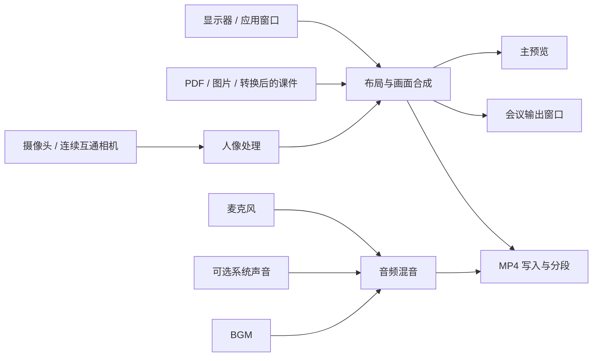

# 课程录制工具 · Course Recorder

面向个人知识创作者的 macOS 原生录课与课程视频制作工具。把摄像头、课件、屏幕操作和声音组合成四种可切换的镜头，用于录制桌面教程、制作手机竖屏课程，也能通过独立输出窗口展示给会议中的其他人。

支持两种录课方式：**边讲边录**，或**先录口播、再配操作与画面**。主程序使用 Swift 和 Apple 系统框架，通过 Swift Package Manager 构建，没有第三方 Swift 包依赖；课件转换和 AI 功能使用可选的外部工具。

> **当前版本：1.4.2 · 文档更新：2026-10-26**
>
> **项目阶段：本机可用，持续试用迭代。** 已有短时实录、合成媒体和文件级回归验证，手动口播制作的基本流程已由使用者确认。长时间录制、真实课程 AI 效果、iPhone 实际连接及会议端共享仍需进一步验收。当前以源码本地构建为主，尚未提供经过 Apple 公证的公开发行包。

## 目录

- [1. 项目定位与当前状态](#1-项目定位与当前状态)
- [2. 功能说明](#2-功能说明)
- [3. 环境要求与构建安装](#3-环境要求与构建安装)
- [4. 使用指南](#4-使用指南)
- [5. AI 功能与数据流向](#5-ai-功能与数据流向)
- [6. 架构与目录](#6-架构与目录)
- [7. 验证与稳定性](#7-验证与稳定性)
- [8. 开发与排错](#8-开发与排错)
- [9. 已知限制与后续方向](#9-已知限制与后续方向)
- [10. 贡献与项目许可](#10-贡献与项目许可)

## 1. 项目定位与当前状态

录一节课往往需要同时照顾讲解、人像、幻灯片、屏幕操作和声音。本项目将这些常用操作组合成预设镜头，让一个人也能完成画面组织和录制。

| 使用方式 | 工作流程 | 输出 |
|---|---|---|
| 实时录制 | 讲解时切换镜头、翻页、操作软件 | 本地 MP4、分段录像与打点文件 |
| 口播制作 | 先录制或导入口播，再录制操作、安排镜头并导出 | 项目目录、成片 MP4、可编辑 SRT 字幕 |
| 会议展示 | 打开独立输出窗口，在会议软件中共享这个窗口 | 实时合成画面，无需开始本地录制 |

适合软件教程、知识分享、产品演示、带人像的课件讲解，以及桌面与手机观看场景下的课程制作。

### 工作全景图同步摘要

以下摘要可用于同步项目看板，状态以本仓库实现和已有验证记录为准。

| 项目字段 | 当前说明 |
|---|---|
| 应用名称 | 课程录制工具 / Course Recorder |
| 当前阶段 | 本机可用，持续试用迭代 |
| 当前版本 | 1.4.2 |
| 核心能力 | 四镜头、横竖屏、摄像头与屏幕捕捉、人像处理、录制与分段保存、口播制作、可审核的 AI 草稿、字幕、会议输出窗口 |
| 已有验证 | 短时真机录制、分段音视频核对、合成制作与导出、画幅与追踪几何检查、输出窗口生命周期检查；手动口播基本流程已有使用者反馈 |
| 待验收 | 真实课程 AI 处理、iPhone 连续互通相机、会议客户端端到端效果、1 小时以上实录和 30 分钟以上口播导出 |
| 下一里程碑 | 用真实课程完成短课全流程，再验证长时间录制与导出 |

## 2. 功能说明

### 四种镜头

| 镜头 | 横屏 16:9 | 竖屏 9:16 |
|---|---|---|
| **1 出镜** | 人像铺满，支持缩放、位置微调和人脸追踪 | 竖屏人像构图，随人脸左右移动平滑调整 |
| **2 讲解** | 课件或选定画面，加可隐藏的人像小窗 | 默认完整显示课件，空余区域由背景填充，也可选择铺满 |
| **3 演示** | 屏幕或应用窗口，加人像小窗、点击高亮和跟随放大 | 默认取源画面左半边，也可完整显示，空余区域由背景填充 |
| **4 分屏** | 内容与人像左右排列 | 内容在约 75% 的主区域内居中，人像默认在底部占 25% |

镜头切换支持平滑转场。小窗可选择圆形、圆角矩形或抠像人物，调整角落、大小、缩放、边框和阴影。横竖屏分屏的位置与比例独立保存；竖屏人像区域可在 18%～40% 之间调整，也可交换上下位置。

### 横屏与竖屏输出

顶栏左侧可直接切换横屏／竖屏；“录制”页显示实际输出像素。

| 分辨率档位 | 横屏 | 竖屏 |
|---|---|---|
| 1080p | 1920 × 1080 | 1080 × 1920 |
| 2K 1440p | 2560 × 1440 | 1440 × 2560 |
| 4K 2160p | 3840 × 2160 | 2160 × 3840 |

主预览、独立输出窗口、实时录制与制作成片使用同一目标画幅。制作项目会保存自己的画幅，旧项目缺省按横屏读取；原始口播和演示素材保留完整源画幅，由最终布局决定如何裁切。

倒数、录制、暂停、保存、制作播放／预览、素材收尾、导入和导出等处理期间会锁定输出格式，防止正在运行的写入器中途改变尺寸或编码参数。

### 画面来源与课件

- **多显示器和应用窗口**：为讲解、演示选择不同来源；底部来源条随镜头切换，快捷键可循环切换来源。
- **课件导入**：支持 PDF、图片、图片文件夹，以及经转换处理的 PowerPoint／Keynote 等演示文稿。
- **演示文稿转换**：非 Keynote 文件优先使用 LibreOffice，失败后可尝试 Keynote；Keynote 文件由 Keynote 转换。也可以先在原应用导出 PDF 再导入。
- **翻页与构图**：支持全局快捷键、方向键、翻页笔和缩略图；导入页面可拖动、缩放、复位，逐页保留构图。
- **鼠标辅助**：点击高亮、手动跟随放大、点击触发自动放大。
- **后台窗口**：可列出部分其他桌面、隐藏或最小化的应用窗口；窗口能列出不等于画面仍会更新。

导入后的演示文稿是静态页面，不保留原演示动画。需要保留动画时，可直接捕捉正在播放演示文稿的应用窗口。

### 人像与摄像头

- 支持系统识别的内置摄像头、外接摄像头和 iPhone 连续互通相机。
- 支持原始背景、背景虚化、虚拟背景、纯色背景与抠像人物。
- 仓库中的 [bg.png](bg.png) 可作为可选自定义背景，在“人像 → 虚拟背景”的自定义图片入口选择。内置预设背景由程序生成，基础运行不依赖这张图片。
- 提供抠像质量、边缘处理、补洞、磨皮、美白、红润、瘦脸、大眼和清晰度等调节。
- 提供镜像、亮度、对比度、饱和度、色温、缩放与位置调节。
- 顶栏可开关真实摄像头采集；关闭后隐藏人像，重新开启保留构图与处理设置。

**出镜追踪的边界：** “人像 → 人脸居中追踪”用于出镜、小窗和分屏，出镜复用平滑的人脸水平位置，垂直构图仍由用户调整。横屏原画面与输出同为 16:9、缩放为 1.00× 时没有平移余量；适当放大后才有明显跟随空间。竖屏本身有横向裁切空间。追踪不会为了居中强行增加数字放大，靠近源画面边缘时仍受原始画幅限制。

### 声音

- 选择麦克风并显示实际输入设备名称、输入电平和设备异常提示。
- 麦克风增益、高通、噪声门和限幅处理。
- 可选录入系统声音，并调整其增益。
- BGM 播放列表、循环、淡入淡出、人声闪避和监听。
- 根据摄像头延迟调整录制音画同步，音频按整数采样连续累计。

麦克风静音不会同时静音系统声音和 BGM。摄像头采集默认 30 fps、输出目标默认 60 fps；两者独立，60 fps 输出不代表摄像头每秒采集 60 张不同画面。

### 录制与文件保护

- MP4 容器，H.264 或 HEVC，30／60 fps，标准／高／极高画质。
- 倒计时、暂停／继续、章节与口误打点。
- 默认每 10 分钟切换新文件；可调整间隔或关闭分段。
- 分段写入失败时尝试续录到新文件，并给出提示。
- 正常停止后可合并本次分段；合并与校验成功后，原分段才移入系统废纸篓。
- 口播重录、导入和成片导出先写新文件，成功后再替换项目引用或旧成片；取消、失败和备份处理有独立保护流程。
- 项目删除使用系统废纸篓，便于恢复。

**这些机制用于降低损失范围，并不保证零丢失。** 已完成收尾的分段通常可以独立使用；正在写入或仍在收尾的文件，在强制结束、掉电或存储故障后可能无法打开。切段后旧段存在短暂收尾期，因此也不能保证异常退出只影响一个文件。磁盘不可写等故障可能同时使续录失败。

## 3. 环境要求与构建安装

### 基础要求

| 项目 | 要求或当前验证范围 |
|---|---|
| 操作系统 | Package.swift 声明 macOS 14 及以上 |
| 构建工具 | SwiftPM、可编译当前系统框架 API 的 Apple SDK／Command Line Tools 或 Xcode 工具链 |
| 包工具声明 | Swift tools 5.10；不表示已验证所有 Swift 5.10 编译器和旧 SDK 组合 |
| 已验证环境 | Apple Silicon、macOS 27、Swift 6.4 工具链 |
| 尚未覆盖 | Intel Mac、Universal 二进制，以及各最低系统版本的完整兼容验收 |
| Swift 包依赖 | 无第三方 Swift 包；可选功能另有外部工具要求 |

### 从源码构建与直接使用

可在 GitHub 上查看项目，也可以用下面的命令克隆。[Maize9623/course-recorder](https://github.com/Maize9623/course-recorder)

```bash
git clone https://github.com/Maize9623/course-recorder.git
cd course-recorder
```

也可从 [Releases](https://github.com/Maize9623/course-recorder/releases) 下载源码 ZIP 并解压，在终端进入仓库根目录。先确认本机已安装合适的 Apple 开发工具：

```bash
swift --version
xcrun --show-sdk-path
```

只编译可执行文件：

```bash
swift build -c release
```

**想直接使用时，运行下面两条命令即可构建并打开本机应用**，不需要先配置 AI、Codex 或办公软件。第一条命令已经包含 Release 编译、打包和签名：

```bash
./scripts/build-app.sh
open "dist/课程录制工具.app"
```

应用包位于 dist/课程录制工具.app，可执行文件位于 .build/release/CourseRecorder。脚本按构建机器的默认架构构建，目前未提供经过验证的 Intel／Universal 打包流程。

想继续 DIY，可直接修改 Sources/CourseRecorder/ 下的 Swift 源码，再运行同一个打包脚本。仓库中的构建与基本使用不依赖维护者的个人设置、录制文件或本机测试工作区；应用首次运行会生成自己的默认设置。全部功能的 Swift 源文件都随仓库提供，录制视频与编译产物不纳入 Git。

打包脚本优先使用本机可用的 Apple Development／Developer ID 签名身份，否则采用 ad-hoc 签名。当前脚本不执行 Apple 公证，也不生成 DMG 或自动更新包。固定应用标识为 com.gene.course-recorder；签名中的 identifier requirement 用于减少本机迭代时重复授权，权限最终仍由 macOS 管理。

**应用正在录制时不要重新打包、覆盖应用包或重启。** 停止后等待“正在保存／合并”完成，再更新。

### 源码包与应用包

发布文件分为两种，方便继续开发或直接使用：

| 文件 | 用途 |
|---|---|
| CourseRecorder-1.4.2-source.zip | 由 Git 提交导出的源码，包含 Swift、构建脚本、资源、背景图和开发文档；解压后按上面的命令构建 |
| CourseRecorder-1.4.2-macos-arm64.zip | Apple Silicon 应用包，附 MIT 许可证、使用说明和可选背景图；解压后将“课程录制工具.app”移入“应用程序” |
| SHA256SUMS | 校验发布文件是否完整，可用 shasum -a 256 核对 |

源码包、应用包和校验文件可从 [v1.4.2 发布页面](https://github.com/Maize9623/course-recorder/releases/tag/v1.4.2) 下载。当前应用包采用 ad-hoc 签名，未经过 Apple 公证，首次打开可能需要在 macOS“隐私与安全性”中确认。Intel Mac 请从源码自行构建，当前没有经过验收的 Intel 应用包。

### 可选依赖

| 功能 | 依赖 |
|---|---|
| PDF／图片课件、实时录制、手动口播制作 | 无需 Codex 或办公软件 |
| 演示文稿转换 | LibreOffice 或 Keynote；两者都没有时可自行导出 PDF |
| 中文口播识别与字幕 | macOS Speech 授权及本机可用的设备端中文识别能力 |
| AI 整理口播／AI 镜头初稿 | 与当前实现兼容的 Codex 程序、ChatGPT 登录和可用额度，详见第 5 节 |
| 文件级诊断 | ffprobe／ffmpeg，仅开发检查需要，不是应用录制的运行依赖 |

### 首次启动与权限

| 权限 | 用途 |
|---|---|
| 摄像头 | 摄像头预览、人像处理和口播录制 |
| 麦克风 | 录制人声 |
| 屏幕与系统录音／屏幕录制 | 捕捉显示器、应用窗口及可选系统声音，名称随系统版本变化 |
| 语音识别 | 首次使用口播识别／字幕时申请 |
| 自动化／控制 Keynote | 使用 Keynote 转换演示文稿时可能申请 |

可在“系统设置 → 隐私与安全性”中查看授权。修改权限后，部分能力可能需要重新打开应用才生效；请先结束录制并等待保存。重新构建保持原 Bundle ID 和签名要求，有助于保留本机授权，但不保证所有系统与分发方式都不会再次询问。

## 4. 使用指南

### 4.1 录一节实时课程

1. 在“录制”页选择分辨率、帧率、画质与保存目录，顶栏选择横屏或竖屏。
2. 在“人像”页选择摄像头、背景与构图，在“音频”页选择实际使用的麦克风，说几句话确认电平。
3. 导入课件，或为讲解／演示选择显示器和应用窗口。
4. 试录一小段并回看声音、文字清晰度和人物构图。
5. 点击“开始录制”；讲解过程中切镜头、翻页、操作软件，需要时打章节或口误标记。
6. 停止录制，等待保存／合并结束，再打开录像检查。

新设置的默认值是 **1080p 横屏、60 fps、H.264、高画质、3 秒倒计时、10 分钟分段**。每台机器的已有设置可能不同，实际以界面为准。

### 4.2 制作手机竖屏课程

1. 点击左上角画幅按钮，切到“竖屏 9:16”。
2. 课件讲解默认完整显示；在“镜头 → 2 讲解”中可切换铺满或完整显示。
3. 软件操作放在源屏幕的左半边，并在“镜头 → 3 演示 → 竖屏取景”选择“左半屏”；需要整个源画面时选择“完整屏”。
4. 分屏默认将人像放在底部，占约 25% 高度，操作内容在其上方主区域居中；按内容调整比例。
5. 用实际手机回看一段，确认文字大小和构图适合观看。

竖屏不会自动把所有桌面文字放大到适合手机阅读。可结合窗口大小、源内容字体、左半屏取景和跟随放大进行构图。

### 4.3 使用 iPhone 摄像头

本项目的摄像头发现包含 AVFoundation 的 continuityCamera 类型，应用也声明了连续互通相机支持；系统将 iPhone 识别为摄像头后，它会成为可选择的输入设备。**这是代码支持状态，尚未完成本项目的 iPhone 真机连接验收。**

Apple 的基本要求为 iPhone XR 或更新机型、iOS 16 或更新版本、Mac 运行 macOS Ventura 13 或更新版本；本工具自身仍要求 macOS 14 及以上。两台设备需使用开启双重认证的同一 Apple 账户，并满足连续互通相机的其他条件。[Apple 系统要求](https://support.apple.com/zh-cn/102546)。

连接步骤：

1. 在 iPhone 的“设置 → 通用 → 隔空播放与连续互通”（部分系统称“隔空播放与接力”）中开启“连续互通相机”。
2. 将手机稳固放在 Mac 附近，锁定手机，让后置相机朝向讲解者，打开 Wi-Fi 和蓝牙；可无线连接，也可用 USB 连接并按提示信任 Mac。
3. 在本工具的“人像 → 摄像头 → 设备”中选择 iPhone；设备连接或断开后，应用会刷新设备列表。
4. 麦克风独立选择，可继续使用自己的外接麦克风。开始正式录课前先做短时试录。

具体连接与故障排除请参阅 [Apple 连续互通相机指南](https://support.apple.com/zh-cn/guide/mac-help/mchl77879b8a/mac)。系统提供的“人物居中”等视频效果受设备条件影响，与本工具的构图跟随分别控制。

### 4.4 先录口播，再配操作

在顶栏切换到“口播制作”，按项目完成以下步骤：

1. **建立项目与准备口播**：新建项目后录口播，也可导入有视频和音轨的 MP4／MOV／M4V。导入会保存项目内副本、处理方向和画幅；不同宽高比可能补边，原文件保留。
2. **整理口播与字幕**：可让 AI 生成重复／重录删减建议，逐条选择、试听原片段、预览剪后效果，再应用；也可只生成字幕。字幕为可编辑 SRT，目前不烧录进画面。
3. **配操作**：播放口播，同时切镜头、翻页、切换演示源、放大和显隐小窗。演示源在配操作播放期间录成素材，并记录到同一时间线上；配错可“清除此后”重新配。
4. **导出**：等待演示素材收尾，再生成成片。可选择是否加入 BGM，以及沿用默认播放列表或为项目选单首音乐。

重录成功后会保留旧口播备份，导入替换和剪辑也有项目备份；口播时长变化后需要重新安排操作。导出先写临时文件，成功后才替换旧成片。项目删除会将整个项目文件夹移到系统废纸篓。

制作项目包含口播、演示素材与时间线，备份项目时应保存整个文件夹，不能只复制 project.json。

### 4.5 在飞书、腾讯会议或 OBS 中展示

1. 在本工具中准备好画面，点击顶栏右侧“共享”。
2. 打开独立窗口 **“会议共享画面 · 课程录制工具”**。
3. 在会议软件里选择共享这个窗口；OBS 可用窗口捕捉选择同一窗口。
4. 回到本工具切镜头、翻页和操作，输出窗口实时显示合成结果。无需开始本地录制；需要保存录像时可另行开始录制。

共享期间保持输出窗口打开，不要最小化。窗口输出有独立的防休眠活动，关闭这个窗口不会停止合成引擎和其他画面消费者。会议客户端对窗口共享、最小化及画质的规则，以其实际版本为准：[飞书说明](https://www.feishu.cn/hc/en-US/articles/360046586533-share-your-screen)、[腾讯会议说明](https://meeting.tencent.com/support/topic/1495/index.html)。

**声音在会议中单独设置。** 发言使用会议软件选择的真实麦克风；本工具的静音不会替代会议静音。播放视频时按会议提示设置“共享电脑声音”。本工具目前没有虚拟麦克风，内部混音和 BGM 不会自动注入会议。

会议输出已完成本地窗口与合成帧检查，尚未完成飞书／腾讯会议的实际端到端验收。

### 4.6 快捷键

默认前缀均为 **Control + Option（⌃⌥）**，可在“快捷键”页修改。

| 快捷键 | 操作 | 快捷键 | 操作 |
|---|---|---|---|
| ⌃⌥1／2／3／4 | 出镜／讲解／演示／分屏 | ⌃⌥R | 开始／停止录制 |
| ⌃⌥V | 显示／隐藏小窗 | ⌃⌥P | 暂停／继续 |
| ⌃⌥S | 切换当前镜头的画面来源 | ⌃⌥M | 章节打点 |
| ⌃⌥Z | 鼠标跟随放大 | ⌃⌥N | 口误打点 |
| ⌃⌥]／⌃⌥[ | 下一页／上一页 | ⌃⌥B | BGM 播放／暂停 |
| ⌃⌥Y | 提词器开始／暂停 | ⌃⌥L | 显示人名条 |
| ⌃⌥H | 显示／隐藏悬浮控制条 | ⌃⌥A | 本工具麦克风静音 |

启用对应选项后，导入课件正在显示时可使用全局 ←／→ 翻页，或使用 PageUp／PageDown 翻页笔。以“快捷键”页显示的实际绑定为准。

### 4.7 保存位置和项目文件

默认录像目录可在“录制”页修改。下面是通用路径与项目结构示例，不包含个人素材。

| 内容 | 默认位置 |
|---|---|
| 实时录制与分段文件 | ~/Movies/课程录制/ |
| 口播制作项目 | ~/Movies/课程录制/项目/项目名称/ |
| 应用设置 | ~/Library/Application Support/CourseRecorder/settings.json |
| 课件转换缓存 | ~/Library/Application Support/CourseRecorder/Slides/ |

```text
项目名称/
├── project.json                  # 项目、画幅、时间线和素材引用
├── 口播.mp4                     # 新录口播；导入或剪辑后文件名可能不同
├── 演示/                        # 配操作时录制的 take 素材
├── 音乐/                        # 项目专用音乐副本（可选）
├── 口播文字稿.json              # 本机识别的文字和时间缓存
├── 成片.mp4                     # 导出结果
├── 时间线备份/                  # 采纳镜头草稿前的项目元数据备份（按操作生成）
└── 导入前备份/                  # 替换口播前的项目元数据备份（按操作生成）
```

实际文件名以 project.json 中的引用为准。项目元数据可能引用项目外的原始课件，移动项目时也应检查课件来源是否仍可用；项目内媒体备份与元数据备份的范围并不相同。

**两种 SRT 文件用途不同：** 实时录制生成的 .markers.srt 是章节／口误时间标记，不是语音识别字幕；口播制作中的字幕功能才会生成与口播词语时间对齐的字幕 SRT。

高画质、H.264、60 fps 下，1080p 的目标码率约 16 Mbps，1440p 约 28 Mbps，纯视频空间约为每分钟 120 MB／210 MB；实际大小还受音轨、时长和编码设置影响。配操作期间另有演示素材，项目占用可能明显大于最终成片。

## 5. AI 功能与数据流向

AI 功能是可选的，不影响实时录制、手动口播配操作或会议画面输出。

### 当前 AI 可以做什么

| 功能 | 输入 | 输出与人工控制 |
|---|---|---|
| 中文识别与字幕 | 本机口播音频 | 逐词／句级文字与时间，生成可编辑 SRT |
| 保守整理口播 | 带词语时间的文字稿 | 重复／重录等删减建议；逐条试听、选择、预览后应用，可恢复剪前项目 |
| 镜头初稿 | 文字稿、课件文字、已有演示素材的时间范围 | 镜头、页码、来源等时间线草稿；先审核与预览，再采纳或放弃 |

AI 不会补出未录制的演示画面；演示区间需要完整素材覆盖。扫描课件或图片页无法提取文字时，会影响镜头规划信息量，当前没有用 OCR 识别这些页面。

### 登录和运行依赖

应用的“制作”页提供“连接 ChatGPT / Codex”“检查登录”和“测试连接”。检查登录只确认登录方式；测试连接会发送无课程内容的小型请求，验证一次实际调用。后续规划仍受任务规模、账户额度、权限和网络影响，连接测试不会预留额度。

**当前实现存在一项移植限制：** AIShotPlanner 与 CodexConnection 默认使用以下固定程序路径：

```text
/Applications/ChatGPT.app/Contents/Resources/codex-cli/bin/codex
```

当前不会自动从 PATH 或其他独立应用位置寻找 Codex，也没有在界面上配置 CLI 路径的入口。因此，仅安装任意版本的独立 Codex CLI，不代表本项目当前就能找到并运行它。使用 AI 前需确认上述程序确实存在，且支持当前代码使用的登录与结构化输出参数；具体桌面版的内部目录不作为稳定接口保证。普通录制和手动制作可先独立使用。

本项目目前只接受 Codex 的 **ChatGPT 登录方式**，不提供 API Key 调用路径。它复用本机 Codex 的登录状态，尚未实现应用独立的账号隔离；在应用中重新登录会影响共享该状态的本机 Codex 使用。OpenAI 自身支持多种 Codex 登录方式，具体区别见 [OpenAI 官方认证文档](https://learn.chatgpt.com/docs/auth)；本项目的限制以此处说明和源码为准。

### 哪些数据留在本机，哪些会联网

| 数据或处理 | 当前行为 |
|---|---|
| 摄像头、屏幕和口播原始音视频 | 在本机采集、处理、保存；本项目的 AI 规划不上传这些文件 |
| 中文语音识别 | 要求设备端识别，需 macOS 授权及本机中文识别支持；不可用时提示处理，不自动改为云端识别 |
| AI 整理／镜头规划材料 | 将文字稿、词语时间、课件可提取文字和素材时间等必要元数据通过 Codex 发送进行规划 |
| 项目、识别缓存和备份 | 保存在本机文件系统中，可能包含课程内容和来源路径 |
| 会议共享 | 由用户选择的会议软件传输共享画面和相应声音，不属于本项目的 AI 规划链路 |

生成草稿不会直接替换项目。采纳前会核对项目状态并保存备份；放弃保留原时间线。AI 识别、删减判断、断句、字幕文字及镜头安排仍需人工试听和回看。

## 6. 架构与目录

实时录制与离线导出复用同一套布局和合成引擎；实时预览、会议输出和录像分别作为画面消费者。



口播制作按口播时间驱动已录制素材、镜头事件、页码和鼠标信息，再通过独立的离线写入器导出成片。

```text
.
├── Package.swift
├── Resources/                  # 应用信息与图标
├── scripts/build-app.sh         # 构建、打包与签名
└── Sources/CourseRecorder/
    ├── App/                    # 设置、应用状态、权限、快捷键与项目操作
    ├── Capture/                # 摄像头、麦克风、屏幕、鼠标与最新帧存储
    ├── Processing/             # 人像分割、美颜和形变处理
    ├── Render/                 # 布局、合成、课件、资源与渲染循环
    ├── Audio/                  # 音频读取、处理、混音与 BGM
    ├── Recording/              # MP4 写入、采样时间轴和分段
    ├── Production/             # 项目、口播、时间线、AI、字幕与离线导出
    ├── UI/                     # 主界面、设置、控制条、提词器与输出窗口
    ├── *SelfTest.swift         # 各项命令行自测
    └── main.swift              # 应用与诊断入口
```

| 部分 | 主要系统技术 |
|---|---|
| 界面 | SwiftUI + AppKit |
| 摄像头与媒体文件 | AVFoundation |
| 屏幕与窗口采集 | ScreenCaptureKit |
| 人像与人脸处理 | Vision |
| 合成和图像处理 | Core Image + Metal |
| MP4 与硬件编码 | AVAssetWriter + VideoToolbox |
| PDF 课件 | PDFKit |
| 设备端语音识别 | Speech |

项目采用“使用者提出需求与试用反馈、AI 编码助手协作实现与检查”的开发方式。功能、验证范围和限制以可重复的代码与结果为依据，不按代码量估算完成比例。

## 7. 验证与稳定性

### 已有验证记录

下面记录的是对应环境和版本中的结果，不是对所有设备、时长和使用情形的保证。检查数可能包含嵌套项目，不应相加作为覆盖率。

| 验证 | 已有结果 | 范围 |
|---|---|---|
| 短时真机录制 | 使用者约 5 分钟实录已确认完整；另有 60 秒自动切镜头录制检查 | 不代表 1 小时以上录制已验收 |
| 手动口播制作 | 使用者确认录口播、配操作和导出基本流程可用 | 未覆盖所有异常保存与设备边界 |
| 分段写入回归 | 横竖输出的 23 秒压力检查：各 5 段、1,366 帧，音视频总长各 23.000 秒，写入丢帧为 0 | 高码率噪点、时间抖动与跳帧的合成输入 |
| 口播制作与取消导出 | 合成成片 10 秒／300 帧；取消重导出后原成片保持不变 | 合成素材与短项目 |
| 横竖画幅 | 49 项 CPU、65 项几何／合成媒体检查，含 4 秒／120 帧竖屏成片 | 媒体检查包含 CPU 项目 |
| 出镜追踪 | 18 项几何检查 | 真实人物移动时的观感仍需试用 |
| 格式锁与项目恢复 | 64 项状态检查 | 合成／隔离项目，不改个人设置 |
| 会议输出窗口 | 21 项本地合成检查，含不开录制出帧、开关窗口、其他消费者持续与横竖比例 | 未进入真实会议 |
| 外部口播导入 | 78 项合成检查 | 不等于已测所有外部编码组合 |
| 独立源码构建 | 从干净 Git 仓库重新克隆后，Release 编译、应用打包与签名校验通过；快捷开关 23 项、画幅 49 项、追踪 18 项 CPU 检查，快捷开关媒体 60 项、导入预览 34 项检查通过 | Apple Silicon；后两项自测现场生成素材，不依赖未入库视频 |
| AI 相关 | 已有 CPU、进程生命周期、合成文字实际规划及剪辑媒体检查 | 真实中文课程的识别与判断仍待验收 |

### 运行自测

以下命令从仓库根目录执行。纯 CPU 检查不会打开摄像头或录屏；媒体、写入、界面与真机检查会消耗资源，**使用者正在录课或试用时不要运行 GPU 检查**。带 live 的 AI 检查会联网并使用当前账户额度，应在明确需要时运行。

```bash
# 纯 CPU：画幅、出镜构图与快捷开关
.build/release/CourseRecorder --output-aspect-cpu-test
.build/release/CourseRecorder --presenter-tracking-test
.build/release/CourseRecorder --device-quick-toggle-test

# 本地合成媒体与状态：不启动真实捕捉设备
.build/release/CourseRecorder --output-aspect-test .selftest/aspect --no-capture
.build/release/CourseRecorder --output-format-state-test .selftest/state --no-capture
.build/release/CourseRecorder --meeting-output-test .selftest/meeting --no-capture
.build/release/CourseRecorder --device-quick-toggle-media-test .selftest/toggle --no-capture
.build/release/CourseRecorder --narration-import-preview-test .selftest/import-preview --no-capture

# 23 秒写入压力检查：横屏与竖屏
.build/release/CourseRecorder --writer-test .selftest/writer 23 0.08 noise-jitter-skip-seg5
.build/release/CourseRecorder --writer-test .selftest/writer-portrait 23 0.08 noise-jitter-skip-seg5-portrait

# 合成口播制作全流程，默认使用合成人像
.build/release/CourseRecorder --production-test .selftest/production

# 合成界面；--width 可检查窄窗口
.build/release/CourseRecorder --ui-snapshot .selftest/ui --portrait --scene split --width 1200 --no-capture
```

文件级检查示例，需要安装 ffprobe：

```bash
ffprobe -v error \
  -show_entries stream=codec_type,width,height,start_time,duration,nb_frames \
  -of compact "/path/to/movie.mp4"
```

分段检查还可使用随仓库提供的脚本，传入首段文件，自动汇总同目录中对应的后续分段：

```bash
python3 scripts/check-segments.py "/path/to/首段.mp4"
```

脚本需要 Python 3 和 ffprobe，核对流元数据、编号与音视频总时长，默认允许 1 毫秒误差；它不解码画面，也不证明跨段内容没有缺口或重复。更多自测入口可直接查看 [main.swift](Sources/CourseRecorder/main.swift)。

## 8. 开发与排错

### 修改录制与导出时的约定

- 保持 Bundle ID 和签名 designated requirement 稳定；修改身份会影响授权关系。
- Recorder 音频使用整数采样累计；改动后检查音视频总长与分段连接。
- 不使用已验证会引起本项目 MP4 收尾失败的 movieFragmentInterval 写法。
- 离线导出按写入器的 inputReadiness 交替提供音视频，音频完成后调用 finishAudioInput()。
- 画面引擎接口保持时间参数化，供预览和离线导出共用。
- 任何创建 AppState 的离屏工具必须设置 persistsSettings = false，避免写入使用者设置。
- GUI 使用 ViewState 包装状态；SwiftUI 画布应明确写 SwiftUI.Canvas，避免与渲染 Canvas 同名。
- 正在录制时不运行 GPU 压力检查，不覆盖应用包或重启；正常退出应等待文件收尾。

### 常见问题

| 现象 | 检查方向 |
|---|---|
| 摄像头／麦克风无画面或声音 | 检查设备选择、实际设备名称、macOS 权限、连接状态；做短时回听 |
| 找不到 iPhone 摄像头 | 核对 Apple 连续互通条件，检查手机固定／锁定状态，尝试 USB 并确认信任提示 |
| 录制没有系统声音 | 在音频页检查系统声音选项及系统录制权限；会议共享声音另在会议客户端设置 |
| 横屏追踪没有移动 | 检查追踪开关与缩放；同为 16:9 的 1× 全景没有平移余量 |
| PPT 无法导入 | 检查 LibreOffice／Keynote，或先从原应用导出 PDF |
| PPT 动画没有保留 | 静态转换的预期行为；可改捕捉正在放映的窗口 |
| 最小化的应用画面不更新 | 恢复窗口；源可列出不代表仍能得到更新帧 |
| AI 提示找不到 Codex | 检查第 5 节固定路径限制，不要只根据终端 PATH 中有 codex 判断 |
| 已登录但 AI 失败 | 用“测试连接”区分实际调用、账户权限、可用额度与网络问题 |
| 设备端中文识别不可用 | 检查语音识别授权和当前系统语言资源；本项目不会自动改走云端识别 |
| 会议没有听到 BGM | 输出窗口只提供视频，不会自动把本工具混音送到会议麦克风 |
| 录像文件损坏 | 保留原文件与其他分段；未完成 MP4 收尾的文件不保证可修复 |

查看本机性能日志：

```bash
/usr/bin/log show --last 5m --style compact \
  --predicate 'subsystem == "com.gene.course-recorder"'
```

反馈问题时请提供应用版本、macOS／芯片、所用设备、目标画幅、复现步骤与相关错误摘要。日志、项目元数据和截图可能包含课程内容、个人路径或账户信息，请先检查再公开。

## 9. 已知限制与后续方向

### 已知限制

- 目前主要在一台 Apple Silicon Mac 上迭代，尚无完整跨设备与跨系统兼容矩阵。
- 尚未完成 1 小时以上实录和 30 分钟以上口播导出验收；高负载、散热、可用磁盘和外接设备都会影响效果。
- 摄像头处理、输出和会议传输有不同帧率；会议最终清晰度与流畅度受会议客户端和网络影响。
- iPhone 摄像头在代码层面支持，尚未完成本项目的实际连接验证。
- AI 会有识别或规划误差，图片课件语义信息有限，真实课程效果需人工审核。
- 当前不能拖动单个时间线镜头标记；可以审核草稿或“清除此后”重新配操作。
- 字幕可导出和编辑，尚未烧录进成片。
- 当前会议接入方式为独立窗口共享；未提供虚拟摄像头、虚拟麦克风或 RTMP 直接推流。
- Codex 程序路径尚未做通用发现／配置，登录也未独立隔离。
- 尚未提供 Apple 公证、DMG、自动更新或正式发行流水线。

### 后续优化方向

以下为候选方向，不表示已开始或承诺交付时间：

1. 真实短课全流程验收，补充设备、会议与长时间录制验证。
2. 完善 Codex 程序发现、可配置路径及账号边界提示。
3. 时间线单个镜头编辑、字幕校对与可选烧录。
4. 高负载下的处理策略与长时间导出性能优化。
5. 虚拟摄像头／音频输出与直播推流。
6. 分发签名、公证、安装包与自动更新。

## 10. 贡献与项目许可

### 参与开发

改动应围绕可复现的问题或具体使用流程，优先保护录制、项目素材与成片保存。建议在提交中说明问题、最终行为、验证方法和仍未覆盖的范围。新增依赖、修改签名身份或调整音视频写入流程前，应先说明影响。

公开演示应使用自制或有明确授权的合成素材，示例中使用通用路径，不包含真实课程、聊天记录、第三方人像或本地账户信息。内部交接资料和测试工作区不自动属于对外文档。

### 项目许可

本项目采用 **[MIT License](LICENSE)**，许可证标识为 MIT。允许使用、复制、修改、合并、发布、分发、再许可及商业使用；分发软件副本或实质部分时，需保留版权声明和许可声明。软件按许可证中的“AS IS”条款提供。

版权声明使用 **2026 Course Recorder contributors**。除文件另有明确说明外，仓库内项目源码、文档及随仓库提供的背景资源使用同一许可证；使用者自行导入的课程、图片、音视频与第三方工具不因此改变其原有许可。完整条款以 [LICENSE](LICENSE) 为准，标准文本可参阅 [SPDX MIT 条目](https://spdx.org/licenses/MIT.html)。
